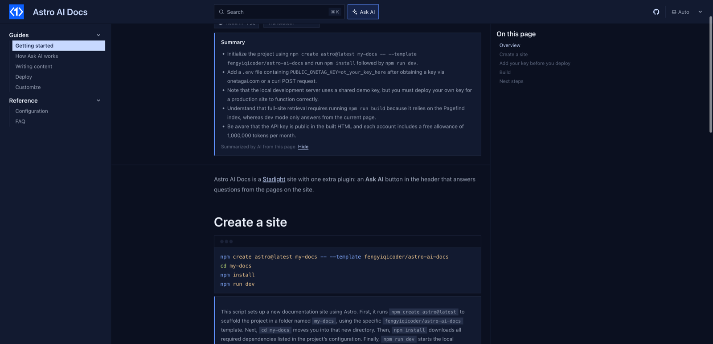

# starlight-onetag-explain

An **Explain this code** button under every code block in your [Starlight](https://starlight.astro.build) docs. Readers get a plain-language walkthrough of the snippet, written by AI in the browser, including what they need to change before running it.



- Works with Expressive Code blocks (Starlight's default) and plain `<pre>` blocks.
- The explanation knows the page title, the section and the paragraph before the code, so it explains the snippet in context.
- Answers in the page's language.

Live demo: the [Astro AI Docs](https://fengyiqicoder.github.io/astro-ai-docs/) template runs every starlight-onetag plugin.

## Install

```bash
npm install starlight-onetag
```

This plugin ships inside the [`starlight-onetag`](https://www.npmjs.com/package/starlight-onetag) package (0.2.0 and later) as `starlight-onetag/explain`. This repository holds its source and docs.

```js
// astro.config.mjs
import { defineConfig } from "astro/config";
import starlight from "@astrojs/starlight";
import starlightOnetagExplain from "starlight-onetag/explain";

export default defineConfig({
  integrations: [
    starlight({
      title: "My docs",
      plugins: [starlightOnetagExplain()],
    }),
  ],
});
```

## Before you deploy: get a free key

On localhost it works without a key, on a shared demo key. A deployed site needs its own: pass it as `starlightOnetagExplain({ key: "ot_..." })` or set `PUBLIC_ONETAG_KEY` in `.env`. Without one, readers see a line saying AI is not set up, and the build prints a warning.

Fill in your email at [onetagai.com](https://onetagai.com/?ref=starlight-onetag-explain), or run this; the key arrives in that inbox (one key per email, 1,000,000 free tokens a month):

```bash
curl -X POST https://onetagai.com/api/signup -H "Content-Type: application/json" -d '{"email":"you@example.com"}'
```

The key is designed to be public, like an analytics ID: it ends up in the built HTML and can only spend that account's allowance. One key works for every starlight-onetag plugin on the site.

## Options

| Option | Default | What it does |
| --- | --- | --- |
| `key` | `""` (or `PUBLIC_ONETAG_KEY`) | The OneTag AI key. |
| `label` | `"Explain this code"` | Button text. |
| `minLines` | `1` | Only add the button to blocks with at least this many lines. |
| `lang` | page language | Language of the explanations. |
| `rules` | see `index.js` | Instructions given to the model. |
| `maxTokens` | `600` | Answer length cap. |
| `site` | `https://onetagai.com` | Where the API lives, for self-hosted deployments. |

## How it works

1. On click, the code, its language and file name, the section heading and the paragraph before it go to OneTag AI from the browser through the [`onetagai`](https://www.npmjs.com/package/onetagai) package.
2. The answer streams into a panel under the block.

The plugin adds no component overrides, so it works next to any other Starlight plugin or custom component. The AI code is a separate chunk loaded the first time a reader uses the feature; page speed stays where it was. Nothing is stored on a server: OneTag AI keeps token counts and timestamps, not page text or questions.

## More AI for Starlight

- [starlight-onetag](https://github.com/fengyiqicoder/starlight-onetag): Ask AI dialog next to the search box, answered from your pages
- [starlight-onetag-search](https://github.com/fengyiqicoder/starlight-onetag-search): AI answer inside the search dialog, above the Pagefind results
- [starlight-onetag-translate](https://github.com/fengyiqicoder/starlight-onetag-translate): "Read in <your language>" button: AI translation of the page for the reader
- [starlight-onetag-summary](https://github.com/fengyiqicoder/starlight-onetag-summary): "Summarize this page" box at the top of long pages
- [starlight-onetag-selection](https://github.com/fengyiqicoder/starlight-onetag-selection): select any text, click Ask AI, get it explained in context

## License

MIT. Powered by [OneTag AI](https://onetagai.com/?ref=starlight-onetag-explain).
